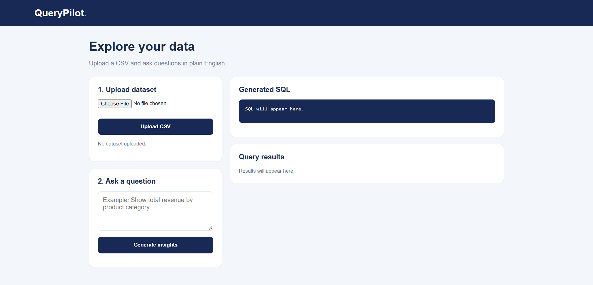
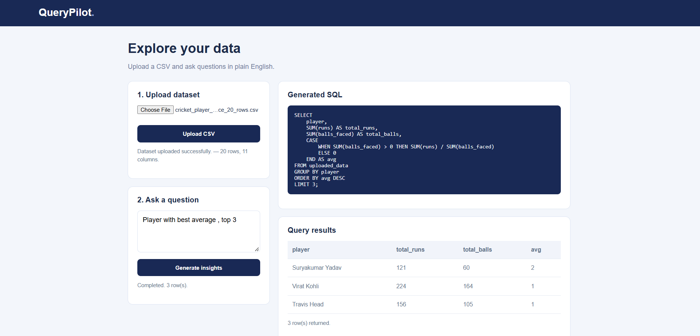
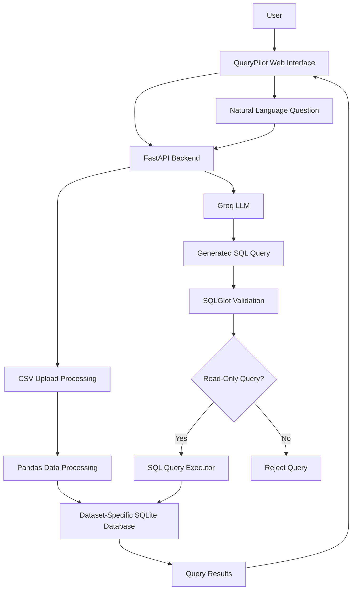

# QueryPilot — Natural Language to SQL Analytics Assistant

**Ask questions about your data. Get SQL. Discover insights.**

QueryPilot is an AI-powered analytics platform that allows users to upload CSV datasets and interact with their data using natural language. It converts everyday questions into SQL queries, validates them for safety, executes them against structured data, and presents the results through a web interface.

The goal is to make data analysis more accessible by reducing the need to manually write SQL queries.

<p align="center">
  <a href="https://querypilot-mu.vercel.app/">
    <strong>🚀 Live Application</strong>
  </a>
  &nbsp; | &nbsp;
  <a href="https://querypilot-kfnx.onrender.com/">
    <strong>⚡ API</strong>
  </a>
  &nbsp; | &nbsp;
  <a href="https://github.com/kumawatmanish05/QueryPilot">
    <strong>💻 GitHub Repository</strong>
  </a>
</p>

---

## Project Overview

Traditional data analysis often requires users to understand database structures and write SQL queries manually.

QueryPilot simplifies this workflow.

Users can upload a CSV file, ask questions in plain English, and receive generated SQL queries along with the corresponding results.

For example:

**User question:**

> Which product generated the highest revenue?

**Generated SQL:**

```sql
SELECT product,
       SUM(quantity * unit_price) AS revenue
FROM uploaded_data
GROUP BY product
ORDER BY revenue DESC
LIMIT 1;
```

QueryPilot validates the generated SQL before execution and restricts database operations to read-only queries.

---
## 📸 Application Screenshots

### Dashboard


### Query Results


## 🎥 Project Demo

[▶ Watch QueryPilot in Action](https://github.com/kumawatmanish05/QueryPilot/blob/main/assets/Screen%20Recording%202026-11-02%20092807.mp4)

---
 
## Key Features

- **CSV Dataset Upload:** Upload CSV files and use them as queryable datasets.
- **Dynamic Dataset Processing:** Automatically inspect uploaded dataset columns and create corresponding database tables.
- **Natural Language to SQL:** Convert questions written in plain English into SQL queries using an LLM.
- **SQL Validation:** Validate generated SQL queries using SQLGlot.
- **Read-Only Query Execution:** Restrict execution to safe, read-only SQL operations.
- **Query Result Display:** Display query results directly in the web interface.
- **Dataset-Specific Databases:** Create separate SQLite databases for uploaded datasets.
- **Query Limits:** Apply result limits and execution safeguards.
- **Custom Web Interface:** Interact with datasets through a dedicated HTML, CSS, and JavaScript frontend.

---

## Technology Stack

| Category | Technologies |
|---|---|
| Language | Python |
| Backend | FastAPI |
| Frontend | HTML, CSS, JavaScript |
| LLM Integration | Groq API |
| LLM Model | openai/gpt-oss-20b |
| Database | SQLite |
| Database Toolkit | SQLAlchemy |
| SQL Validation | SQLGlot |
| Data Processing | Pandas |
| API Server | Uvicorn |
| Testing | Pytest |
| Version Control | Git, GitHub |
| Frontend Deployment | Vercel |
| Backend Deployment | Render |

---

## System Architecture



### Application Workflow

1. The user uploads a CSV dataset.
2. The backend processes the file using Pandas.
3. Dataset columns are inspected and the data is loaded into a dedicated SQLite database.
4. The user submits a natural-language question.
5. The backend retrieves the relevant dataset schema.
6. The LLM generates an SQL query based on the question and schema.
7. SQLGlot validates the generated query.
8. Only permitted read-only queries are passed to the executor.
9. SQLAlchemy executes the query against the selected dataset.
10. Results are returned to the frontend and displayed to the user.

---

## SQL Safety and Execution

LLM-generated SQL must be treated as untrusted input.

QueryPilot includes a validation and execution layer designed to prevent unsafe database operations.

### SQL Validation

SQLGlot is used for structural SQL parsing and validation.

The validation layer is designed to:

- Allow permitted `SELECT` statements.
- Reject data modification statements such as `UPDATE`, `DELETE`, and `INSERT`.
- Reject destructive operations such as `DROP`.
- Reject multiple SQL statements.
- Validate nested SQL structures.
- Prevent rejected queries from reaching the database executor.

### Query Execution Safeguards

- Read-only query execution.
- Configurable maximum result rows.
- Query execution timeout.
- SQLAlchemy-based database interaction.

These safeguards provide an additional layer between AI-generated SQL and database execution.

---

## Project Structure

```text
QueryPilot/
│
├── app/
│   ├── main.py
│   ├── ...
│
├── frontend/
│   └── index.html
│
├── data/
│   ├── sample_sales.csv
│   ├── querypilot.db
│   └── datasets/
│
├── tests/
│   ├── ...
│
├── .env.example
├── .gitignore
├── requirements.txt
├── requirements-dev.txt
└── README.md
```

*Note: The ellipses represent additional application modules and test files.*

---

## Installation and Local Setup

### 1. Clone the Repository

```bash
git clone https://github.com/kumawatmanish05/QueryPilot.git

cd QueryPilot
```

### 2. Create a Virtual Environment

```bash
python -m venv .venv
```

Activate it on Windows:

```powershell
.venv\Scripts\activate
```

### 3. Install Dependencies

```bash
pip install -r requirements.txt
```

For development and testing:

```bash
pip install -r requirements-dev.txt
```

### 4. Configure Environment Variables

Create a `.env` file in the project root.

```env
GROQ_API_KEY=your_groq_api_key
```

Never commit your actual API key to GitHub.

### 5. Start the Backend

```bash
python -m uvicorn app.main:app --reload
```

Backend:

```text
http://127.0.0.1:8000
```

API documentation:

```text
http://127.0.0.1:8000/docs
```

### 6. Start the Frontend

Open another terminal:

```powershell
cd frontend
python -m http.server 5500
```

Open:

```text
http://127.0.0.1:5500
```

---

## API Endpoints

| Method | Endpoint | Description |
|---|---|---|
| GET | `/` | API health response |
| POST | `/datasets/upload` | Upload and process a CSV dataset |
| POST | `/query` | Generate and execute an SQL query |

### Upload Dataset

**Endpoint:**

```http
POST /datasets/upload
```

The endpoint accepts a CSV file through multipart form data.

Example response:

```json
{
  "dataset_id": "generated_dataset_id",
  "rows_loaded": 20,
  "columns": ["player", "runs", "balls_faced"],
  "message": "Dataset uploaded successfully"
}
```

### Execute Natural Language Query

**Endpoint:**

```http
POST /query
```

Example request:

```json
{
  "question": "Which player scored the highest runs?",
  "dataset_id": "generated_dataset_id"
}
```

Example response:

```json
{
  "question": "Which player scored the highest runs?",
  "sql": "SELECT player, MAX(runs) AS highest_runs FROM uploaded_data;",
  "rows": [
    {
      "player": "Example Player",
      "highest_runs": 112
    }
  ],
  "row_count": 1
}
```

*The response above illustrates the API response structure; actual SQL and results depend on the uploaded dataset and question.*

---

## Testing

QueryPilot uses Pytest for automated testing.

Run the complete test suite:

```bash
python -m pytest -v
```

The project currently has **24 passing tests**.

Testing covers areas including:

- SQL validation.
- Read-only query execution.
- Dataset validation.
- Schema handling.
- Query pipeline behavior.
- Rejection of unsafe queries.

---

## Deployment

QueryPilot is deployed using separate frontend and backend services.

| Component | Platform | Status |
|---|---|---|
| Frontend | Vercel | Deployed |
| Backend | Render | Deployed |
| LLM API | Groq | Integrated |

**Live Application:**  
https://querypilot-mu.vercel.app/

**Backend API:**  
https://querypilot-kfnx.onrender.com/

---

## Current Limitations

QueryPilot is an evolving project. Some production-readiness improvements are still pending:

- Persistent storage for uploaded datasets across backend restarts and redeployments.
- User authentication and authorization.
- Stronger multi-user dataset isolation.
- More comprehensive CSV validation and error handling.
- Production-grade monitoring and logging.
- Additional database support beyond SQLite.

---

## Future Improvements

- User authentication and secure dataset ownership.
- Persistent and scalable dataset storage.
- Support for PostgreSQL and other database systems.
- Query history and saved queries.
- Data visualizations and interactive charts.
- Export query results to CSV and Excel.
- Improved query generation using schema-aware prompting.
- Query explanation and optimization suggestions.
- Better handling of ambiguous natural-language questions.
- Production monitoring and performance optimization.

---

## What Makes QueryPilot Different?

QueryPilot is not simply an LLM wrapper that generates SQL.

It combines natural-language understanding with a structured data-processing workflow and a dedicated SQL validation and execution layer.

The project focuses on making AI-generated database queries useful while introducing safeguards before they reach the database.

It demonstrates practical experience with:

- Large Language Model integration.
- Prompt engineering and schema-aware SQL generation.
- Backend API development.
- Database management.
- SQL parsing and validation.
- Data processing.
- Automated testing.
- Full-stack application deployment.

---

## Author

**Manish Kumawat**

BSc Computer Science | Aspiring Data Analyst / Data Scientist

- GitHub: https://github.com/kumawatmanish05

---

<p align="center">
  <strong>QueryPilot — Ask your data. Get answers.</strong>
</p>
